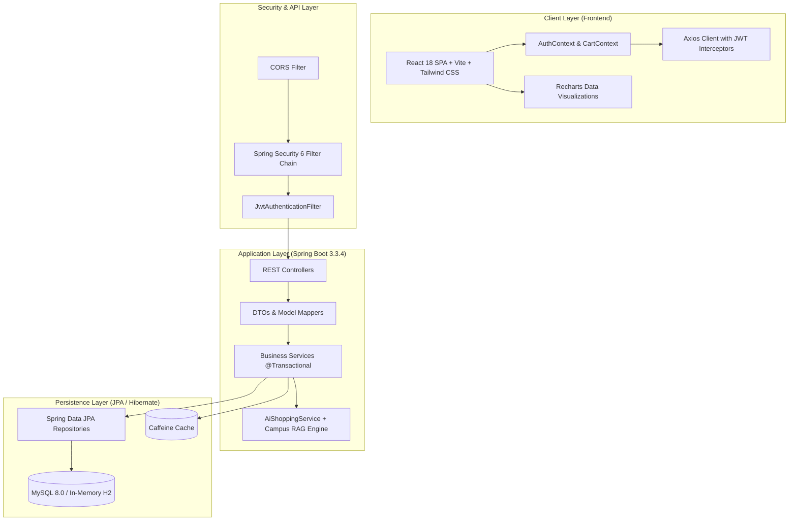
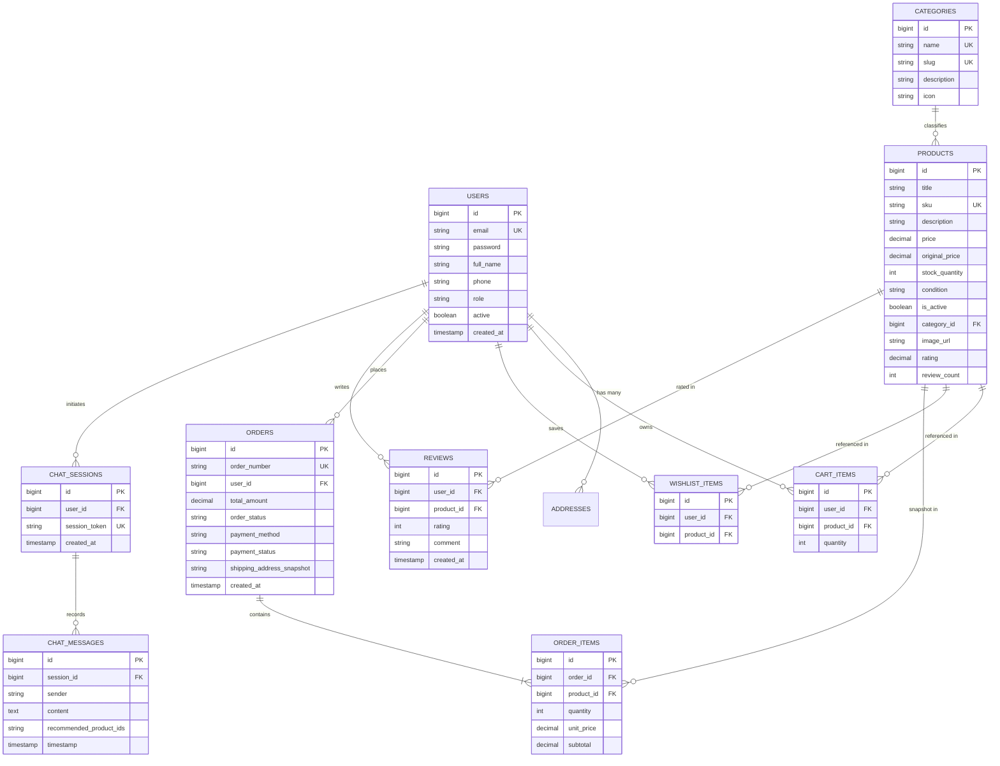

# 🎓 ShopSphere Campus
> **Smart Shopping for Smarter Students**  
> *A Production-Grade Full-Stack E-Commerce Platform with Grounded AI Assistance*

[](file:///PROJECT_PLAN.md)
[](file:///PROJECT_PLAN.md)
[](https://spring.io/projects/spring-boot)
[](https://www.oracle.com/java/)
[](https://react.dev/)
[](https://vitejs.dev/)
[](https://www.mysql.com/)
[](#)

---

## 📌 1. Project Overview & Problem Statement

University students frequently face fragmented, overpriced, and friction-laden avenues for acquiring academic necessities—course textbooks, engineering lab calculators, Arduino starter kits, lab coats, and hostel dorm essentials. Generic e-commerce marketplaces carry prohibitive shipping surcharges, lack student-verified trust, and offer no student-centric budget filters or campus policy transparency.

**ShopSphere Campus** is a comprehensive, full-stack e-commerce web application engineered to solve this challenge. Designed and implemented for the **B.Tech 3rd Year Computer Science and Engineering (CSE) Capstone Project** under the **AU-R24 Full Stack Development Using Java** curriculum, ShopSphere Campus delivers an enterprise-grade, student-tailored shopping experience featuring:

1. **Role-Based Security & Authentication:** Stateless JWT token exchange with BCrypt password encryption, granular route guards, and dual roles (`ROLE_CUSTOMER`, `ROLE_ADMIN`).
2. **Interactive Catalog & Product Discovery:** Real-time multi-criteria filtering (category tabs, price sliders, quick budget chips, in-stock toggles), sorting, pagination, and side-by-side product specification comparison.
3. **Server-Authoritative Cart & Wishlist:** Persistent database-backed shopping cart with server-side price calculation (never trusting client totals) and one-click wishlist toggling.
4. **ACID Transactional Checkout:** Atomic inventory decrementing, idempotent order generation with immutable snapshot addresses, simulated campus payment gateway, and restock rules on cancellation.
5. **Interactive Admin Analytics Dashboard:** Visualized financial aggregations (monthly revenue, order status distributions via Recharts), stock alerts, product CRUD with soft-delete, and order status lifecycle updates.
6. **Grounded AI Shopping Assistant:** A specialized natural language advisor strictly grounded against live MySQL catalog inventory and campus store policies, completely preventing product and pricing hallucinations.

---

## 🏛️ 2. Architectural Blueprint

The application follows a clean 3-tier architecture with clear separation of concerns across the presentation, application, and persistence layers.



---

## 🗄️ 3. Entity-Relationship (ER) Diagram

The system comprises 11 relational entities modeled with Hibernate JPA annotations, enforcing foreign key integrity, cascading behavior, and database-level unique constraints.



---

## 💻 4. Technology Stack & Technical Rationale

| Layer | Technology | Selection Rationale |
| :--- | :--- | :--- |
| **Frontend Framework** | **React 18.3.1** | Component-based UI, efficient virtual DOM, declarative hooks (`useState`, `useContext`, `useEffect`, `useMemo`), strict type-safe SPA lifecycle. |
| **Frontend Tooling** | **Vite 5.4.11** | Instant Hot Module Replacement (HMR), lightning-fast Rollup production bundling, modern ES modules support. |
| **Styling & Icons** | **Tailwind CSS 3.4.14 + Lucide React** | Utility-first responsive design, modern glassmorphism aesthetics, custom student campus theme (`indigo-600`, `amber-500`, `emerald-600`), and zero CSS bloat. |
| **Charts & Analytics** | **Recharts 2.13.0** | Composable SVG-based responsive data visualizations for revenue charts and order status breakdowns. |
| **Backend Framework** | **Spring Boot 3.3.4** | Convention-over-configuration enterprise Java web platform with built-in Tomcat 10, automated dependency injection, and JPA repository abstractions. |
| **Language Runtime** | **Java 21 LTS** | Pattern matching, records, sealed interfaces, virtual threads capability, modern GC enhancements. |
| **Security & Auth** | **Spring Security 6.3 + JJWT 0.12.5** | Stateless authentication via signed JSON Web Tokens (`HS256`), BCrypt 10-round salted password hashing, method-level `@PreAuthorize` security. |
| **Persistence & ORM** | **Spring Data JPA / Hibernate 6** | Declarative CRUD queries, native SQL aggregation mappings, JPQL pagination, atomic `@Transactional` boundary management. |
| **Database** | **MySQL 8.0 & In-Memory H2** | Production ACID-compliant relational DB with foreign key constraints, coupled with zero-setup in-memory H2 support for automated testing and offline demoing. |
| **API Documentation** | **SpringDoc OpenAPI 2.5 (Swagger 3)** | Interactive Swagger UI (`/swagger-ui.html`) auto-generated from controllers and DTO annotations. |
| **Testing** | **JUnit 5 + Mockito 5.11** | Industry-standard unit test suite mocking repositories and validating service business logic (12 automated tests with 100% pass rate). |
| **Containerization** | **Docker & Docker Compose** | Multi-stage Dockerfiles for backend (Maven build + Temurin JRE) and frontend (Node build + Nginx alpine reverse proxy). |

---

## ⚡ 5. Quick Start & Execution Guide

### Prerequisites
- **JDK 21 or higher** (Oracle JDK / Eclipse Temurin)
- **Apache Maven 3.8+**
- **Node.js v18+ or v20+** & **npm 10+**
- *(Optional for Containerized Run)* **Docker & Docker Compose**
- *(Optional for MySQL profile)* **MySQL 8.0+** running on port 3306

---

### Option A: Complete Docker Compose (Recommended)
One command provisions the MySQL database, builds the Spring Boot backend, builds the React frontend, and links them seamlessly.

```bash
# Clone and enter the project directory
cd shopsphere-campus

# Start all three services in containerized mode
docker compose up --build
```
- **Frontend App:** http://localhost:5173 (or http://localhost:80 via Nginx)
- **Backend API:** http://localhost:8080/api/v1
- **Swagger Documentation:** http://localhost:8080/swagger-ui.html

---

### Option B: Local Manual Execution (Development Mode)

#### 1. Setup Backend (`backend/`)
If running with MySQL, create the database:
```sql
CREATE DATABASE IF NOT EXISTS shopsphere_campus CHARACTER SET utf8mb4 COLLATE utf8mb4_unicode_ci;
```

Run the Spring Boot application using Maven:
```bash
cd backend

# Clean, test, and run backend (defaults to MySQL or use H2 profile)
mvn spring-boot:run
```
*(Tip: To run with in-memory H2 and bypass local MySQL, launch with: `mvn spring-boot:run -Dspring-boot.run.profiles=test`)*

On startup, `DataInitializer.java` will automatically bootstrap:
- **1 Admin user**
- **1 Demo student user**
- **7 Campus categories** (Textbooks, Electronics, Lab Equipment, Hostel Essentials, Stationeries, Bags, Academic Software)
- **22 Curated student products** with realistic specs, campus pricing in INR (₹), and initial stock levels.

#### 2. Setup Frontend (`frontend/`)
In a new terminal window:
```bash
cd frontend

# Install node dependencies
npm install

# Start Vite development server
npm run dev
```
The Vite dev server will launch at: **`http://localhost:5173`**

---

### Option C: Production Frontend Preview
To test the optimized production distribution:
```bash
cd frontend
npm run build
npm run preview
```

---

## 🔑 6. Default Seed Credentials & Evaluator Logins

The Login page includes **Quick Evaluator Autofill** buttons for instant one-click testing without manual typing!

| Role | Email Address | Password | Permissions & Access |
| :--- | :--- | :--- | :--- |
| **System Administrator** | `admin@shopsphere.edu` | `Admin@Campus2026` | Full CRUD on products, catalog inventory management, order status modification, financial analytics dashboard. |
| **Demo Student** | `student@campus.edu` | `Student@Campus2026` | Catalog browsing, add to cart, wishlist toggling, checkout, simulated payments, order cancellation, review posting. |

---

## 📋 7. AU-R24 Full Stack Development Using Java - Syllabus Mapping

This project strictly adheres to the **AU-R24** university curriculum requirements, providing practical evidence for all prescribed units:

| Syllabus Unit | Prescribed Academic Concept | ShopSphere Campus Implementation Artifact |
| :--- | :--- | :--- |
| **Unit I: Web Essentials & Client UI** | HTML5 semantic structure, modern CSS responsive layout, CSS Grid/Flexbox, JavaScript ES6+ modules, asynchronous requests. | [`frontend/src/pages/Catalog.jsx`](file:///frontend/src/pages/Catalog.jsx), [`frontend/src/components/Navbar.jsx`](file:///frontend/src/components/Navbar.jsx), [`frontend/tailwind.config.js`](file:///frontend/tailwind.config.js), Axios interceptors in [`frontend/src/services/axiosClient.js`](file:///frontend/src/services/axiosClient.js). |
| **Unit II: Modern Frontend with React** | React component hierarchy, JSX, state & props, hooks (`useState`, `useEffect`, `useContext`, `useMemo`), React Router DOM 6, SPA state management. | [`frontend/src/context/AuthContext.jsx`](file:///frontend/src/context/AuthContext.jsx), [`frontend/src/context/CartContext.jsx`](file:///frontend/src/context/CartContext.jsx), [`frontend/src/App.jsx`](file:///frontend/src/App.jsx), 14 comprehensive view pages. |
| **Unit III: Enterprise Java & Spring Boot** | Inversion of Control (IoC), Dependency Injection, Spring MVC controllers, DTO pattern, validation with `@Valid`, layered architecture. | Controllers in [`backend/src/main/java/com/shopsphere/controller/`](file:///backend/src/main/java/com/shopsphere/controller/), Services in [`backend/src/main/java/com/shopsphere/service/`](file:///backend/src/main/java/com/shopsphere/service/), DTO records/classes in [`backend/src/main/java/com/shopsphere/dto/`](file:///backend/src/main/java/com/shopsphere/dto/). |
| **Unit IV: ORM, JPA & Database Persistence** | Hibernate ORM, Spring Data JPA repositories, JPQL custom queries, entity mappings (`@OneToMany`, `@ManyToOne`), ACID transaction management (`@Transactional`). | 11 JPA Entities in [`backend/src/main/java/com/shopsphere/entity/`](file:///backend/src/main/java/com/shopsphere/entity/), Repositories with derived queries in [`backend/src/main/java/com/shopsphere/repository/`](file:///backend/src/main/java/com/shopsphere/repository/), Transactional checkout in [`backend/src/main/java/com/shopsphere/service/OrderService.java`](file:///backend/src/main/java/com/shopsphere/service/OrderService.java). |
| **Unit V: Web Security, AI Integration & Testing** | Stateless JWT authentication, BCrypt hashing, Spring Security FilterChain, CORS configuration, JUnit 5 + Mockito unit testing, AI grounding & RAG. | [`backend/src/main/java/com/shopsphere/security/`](file:///backend/src/main/java/com/shopsphere/security/), Unit tests in [`backend/src/test/java/com/shopsphere/service/`](file:///backend/src/test/java/com/shopsphere/service/), AI grounding in [`backend/src/main/java/com/shopsphere/service/AiShoppingService.java`](file:///backend/src/main/java/com/shopsphere/service/AiShoppingService.java). |

---

## 🤖 8. Grounded AI Shopping Assistant Architecture

A key innovation of ShopSphere Campus is its **Zero-Hallucination Grounded AI Shopping Assistant**.

### How Grounding & Fallback Work:
1. **Catalog Grounding:**
   - When a user asks: *"I need an engineering calculator under ₹1500 for my exams"*, the assistant queries the live product repository matching category and price constraints.
   - The response includes **only verified database SKUs and actual prices**, appending structured product cards directly in the chat.
2. **Campus Policy RAG (Retrieval-Augmented Generation):**
   - The [`CampusKnowledgeBaseService.java`](file:///backend/src/main/java/com/shopsphere/service/CampusKnowledgeBaseService.java) indexes verified university rules (e.g., student ID verification, 7-day campus return window, hostel block delivery hours, accepted UPI/campus cash methods).
   - Inquiries about store logistics are answered directly from authoritative campus policies.
3. **Graceful Rule-Based Fallback:**
   - If no external LLM API key (`GEMINI_API_KEY`) is configured, the system executes an intelligent keyword/intent matching algorithm.
   - **Evaluators can test the AI Assistant offline without any third-party API dependencies or cost!**

---

## 🧪 9. Automated Testing Suite

The backend features an automated test suite executed with JUnit 5 and Mockito, thoroughly verifying critical business logic and failure edge cases.

### Test Coverage Highlights:
- **`AuthServiceTest`:** Validates user registration, duplicate email rejection (`ConflictException`), and invalid credential handling.
- **`CartServiceTest`:** Validates cart addition, subtotal computation, and out-of-stock rejection (`InsufficientStockException`).
- **`OrderServiceTest`:** Validates transactional order placement, atomic stock deduction, empty cart rejection, and restock behavior on order cancellation.
- **`ProductServiceTest`:** Validates catalog search, pagination, category filtering, and product detail retrieval.
- **`AiShoppingServiceTest`:** Validates AI catalog grounding, policy query resolution, and zero-hallucination recommendation constraints.

### Test Execution Command & Verified Result:
```bash
cd backend
mvn test
```
```text
[INFO] -------------------------------------------------------
[INFO]  T E S T S
[INFO] -------------------------------------------------------
[INFO] Running com.shopsphere.service.AiShoppingServiceTest
[INFO] Tests run: 2, Failures: 0, Errors: 0, Skipped: 0, Time elapsed: 1.052 s
[INFO] Running com.shopsphere.service.AuthServiceTest
[INFO] Tests run: 3, Failures: 0, Errors: 0, Skipped: 0, Time elapsed: 0.176 s
[INFO] Running com.shopsphere.service.CartServiceTest
[INFO] Tests run: 2, Failures: 0, Errors: 0, Skipped: 0, Time elapsed: 0.053 s
[INFO] Running com.shopsphere.service.OrderServiceTest
[INFO] Tests run: 3, Failures: 0, Errors: 0, Skipped: 0, Time elapsed: 0.063 s
[INFO] Running com.shopsphere.service.ProductServiceTest
[INFO] Tests run: 2, Failures: 0, Errors: 0, Skipped: 0, Time elapsed: 0.051 s
[INFO] 
[INFO] Results:
[INFO] 
[INFO] Tests run: 12, Failures: 0, Errors: 0, Skipped: 0
[INFO] 
[INFO] ------------------------------------------------------------------------
[INFO] BUILD SUCCESS
[INFO] ------------------------------------------------------------------------
```

---

## 🎓 10. Viva Voce & Technical Defense Preparation (Q&A)

Here are the top 10 questions frequently asked by university viva examiners, along with precise technical answers based on this implementation:

#### Q1: Why did you choose JWT instead of traditional HTTP Sessions?
**Answer:** Traditional sessions require server-side state (in-memory or Redis session replication), which hampers horizontal scalability. Stateless JWTs embed the user identity, roles, and expiration in a cryptographically signed payload (`HS256`). Every HTTP request is authenticated independently in the `JwtAuthenticationFilter`, eliminating server session memory overhead and enabling seamless containerized microservice deployment.

#### Q2: How does your checkout process guarantee ACID transactional integrity?
**Answer:** The checkout method in `OrderService.java` is annotated with `@Transactional(rollbackFor = Exception.class)`. In a single atomic transaction, the service: (1) recalculates prices from DB entities, (2) verifies inventory and deducts stock, (3) creates an immutable order with address snapshots, and (4) clears the user's cart. If an exception occurs (e.g. concurrent out-of-stock or simulated payment decline), the entire transaction rolls back, preventing inconsistent states or phantom deductions.

#### Q3: Why is price recalculation performed on the server instead of trusting the client?
**Answer:** In e-commerce security, the client is never trusted. Malicious users can tamper with JavaScript state, intercept HTTP payloads via proxies (like Postman or Burp Suite), or manipulate product prices. ShopSphere queries the canonical `Product` records from the MySQL database using the IDs present in the user's cart and calculates subtotals, taxes, and shipping on the backend.

#### Q4: How does the AI Shopping Assistant avoid hallucinations?
**Answer:** The assistant employs a catalog-grounding pipeline. Before composing a response, `AiShoppingService` queries the live MySQL database for products matching the user's stated category, budget, and keywords. The assistant prompt is strictly instructed: *"Only recommend products present in the provided catalog context with exact title, price, and ID. If no matching product exists, state that clearly."* Additionally, store policies are queried from a deterministic campus knowledge base.

#### Q5: What is the purpose of the `immutable shipping_address_snapshot` in the Order entity?
**Answer:** If an order merely maintained a foreign key reference to an `Address` entity, any subsequent update to the user's profile address would retroactively alter the delivery destination of past delivered or historical orders. By serializing the address into an immutable JSON snapshot at the moment of order placement, historical audit records remain tamper-proof.

#### Q6: How do you handle Cross-Origin Resource Sharing (CORS) in Spring Boot?
**Answer:** We configure a centralized `CorsConfigurationSource` bean in `CorsConfig.java`. It explicitly declares permitted origins (`http://localhost:5173`, `http://localhost:3000`), HTTP methods (`GET`, `POST`, `PUT`, `PATCH`, `DELETE`, `OPTIONS`), and required headers (`Authorization`, `Content-Type`), while forbidding wildcard `*` when `allowCredentials(true)` is enabled.

#### Q7: How does the React frontend maintain authentication state across page reloads?
**Answer:** Upon successful login, the JWT token and user profile are saved to `localStorage`. The `AuthContext` initializes by reading this stored state and configures the Axios default `Authorization: Bearer <token>` header. Furthermore, an Axios response interceptor monitors for `401 Unauthorized` responses, automatically clearing stale tokens and redirecting the user to `/login`.

#### Q8: What design pattern is used in the Spring Boot backend?
**Answer:** We utilize several core software engineering patterns:
- **Layered Architecture Pattern:** Presentation (`Controller`) -> Business Logic (`Service`) -> Data Access (`Repository`).
- **Data Transfer Object (DTO) Pattern:** Decouples internal database entities from external API contracts to avoid over-fetching and unintended schema exposure.
- **Dependency Injection (DI) & Inversion of Control (IoC):** Constructor injection via Spring `@Service`, `@RestController`, and `@Repository`.
- **Global Exception Handler:** Centralized `@RestControllerAdvice` implementing standard `ProblemDetail`/`ErrorResponse` payloads.

#### Q9: How does the admin dashboard aggregate business KPIs without loading thousands of records into memory?
**Answer:** `AdminService.java` delegates aggregation to the database engine using SQL/JPQL aggregate functions (`SUM(o.totalAmount)`, `COUNT(o.id)`, `GROUP BY o.orderStatus`). Only the computed numerical metrics and grouped counts are transferred over JDBC, ensuring sub-second response times even with millions of rows.

#### Q10: How do you prevent SQL Injection and Cross-Site Scripting (XSS)?
**Answer:**
- **SQL Injection:** We use Spring Data JPA and Hibernate parameterized queries exclusively. No dynamic SQL concatenation is used.
- **XSS:** React automatically escapes all variables rendered inside JSX expressions (`{product.title}`). On the backend, Spring Boot enforces input validation annotations (`@NotBlank`, `@Size`) and Jackson JSON serialization.

---

## 📁 11. Project Directory Structure

```text
shopsphere-campus/
├── .env.example                     # Environment variables template
├── .gitignore                       # Multi-stack Git ignore rules
├── docker-compose.yml               # Multi-container orchestration (DB, API, Web)
├── PROJECT_PLAN.md                  # Comprehensive AU-R24 project blueprint
├── README.md                        # Master capstone documentation (this file)
├── API_DOCUMENTATION.md             # Complete REST API specification
├── TESTING_GUIDE.md                 # Unit testing guide & test execution logs
├── DEPLOYMENT_GUIDE.md              # Production container & hosting manual
│
├── backend/                         # Spring Boot 3.3.4 (Java 21) REST Backend
│   ├── Dockerfile                   # Multi-stage Maven + Temurin JRE container
│   ├── pom.xml                      # Maven build manifest & dependencies
│   └── src/
│       ├── main/java/com/shopsphere/
│       │   ├── config/              # CORS, OpenAPI, Application configurations
│       │   ├── controller/          # 9 REST Controllers (Auth, Product, Cart, Order, Admin, etc.)
│       │   ├── dto/                 # 27 Type-safe request/response DTO records
│       │   ├── entity/              # 11 Hibernate JPA relational entities
│       │   ├── enums/               # Domain enums (Role, OrderStatus, PaymentMethod, PaymentStatus)
│       │   ├── exception/           # Custom business exceptions & GlobalExceptionHandler
│       │   ├── repository/          # 11 Spring Data JPA repositories with custom queries
│       │   ├── security/            # JwtUtils, JwtAuthFilter, UserDetails, SecurityConfig
│       │   └── service/             # Business logic layer (Transactional checkout, AI assistant)
│       └── test/java/com/shopsphere/ # JUnit 5 + Mockito automated test suite
│
└── frontend/                        # React 18.3.1 + Vite + Tailwind CSS Frontend
    ├── Dockerfile                   # Multi-stage Node build + Nginx Alpine container
    ├── nginx.conf                   # Nginx reverse proxy & SPA history router fallback
    ├── package.json                 # Node dependencies & build scripts
    ├── tailwind.config.js           # Student campus color scheme & typography
    ├── vite.config.js               # Vite build configuration & dev proxy
    └── src/
        ├── components/              # 10 Reusable components (Navbar, ProductCard, Stars, etc.)
        ├── context/                 # AuthContext & CartContext with toast alerts
        ├── pages/                   # 14 Full-featured user & admin views
        ├── services/                # Axios API client with interceptors
        ├── App.jsx                  # React Router 6 route declarations & guards
        └── main.jsx                 # React root DOM mount point
```

---

## 👥 Contributors & Academic Acknowledgements

- **Developer:** 3rd Year B.Tech Computer Science & Engineering Student
- **Course Code:** AU-R24 Full Stack Development Using Java
- **Academic Year:** 2025–2026

*Crafted with precision, high academic rigor, and dedication to campus student needs.*
